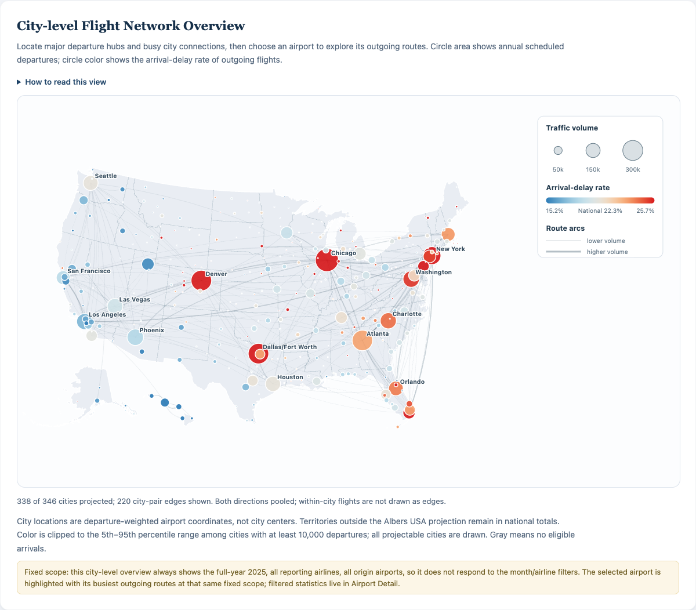
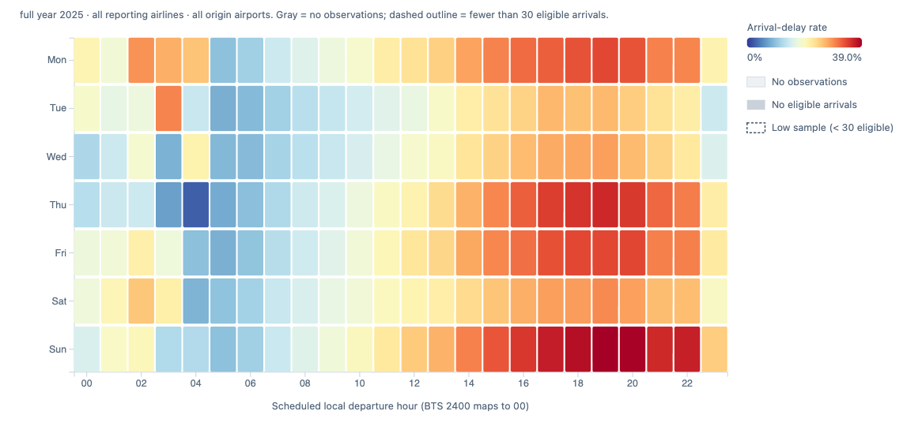
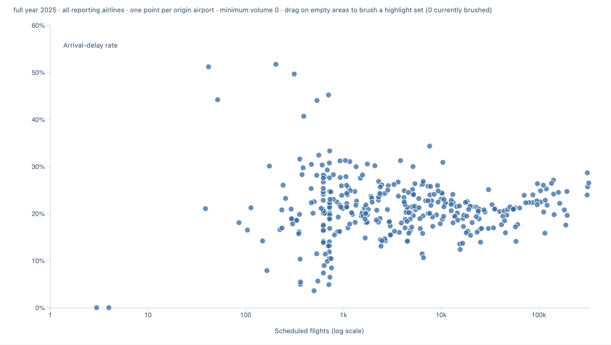
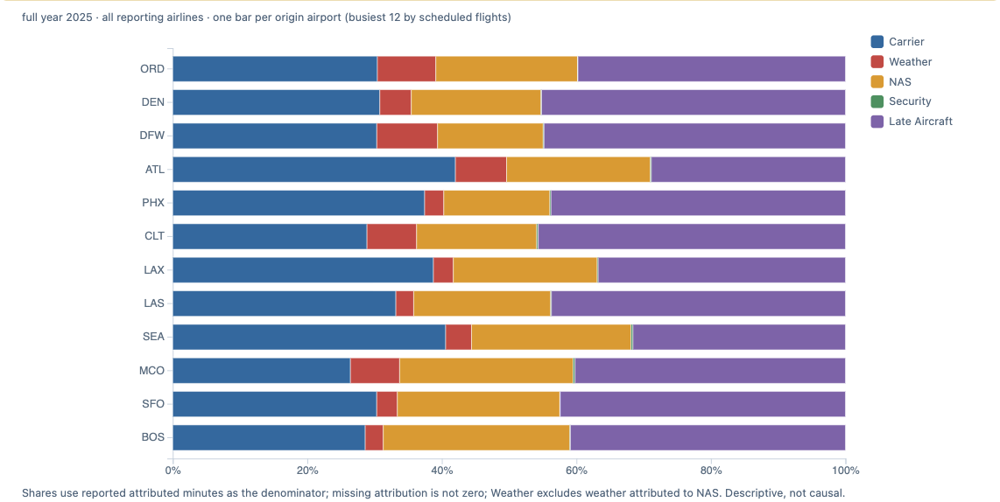

# Delay Across the Network

## An Interactive Visualization of U.S. Domestic Flight Reliability

**STATS 401 Final Project Report**  
**Group 17:** Henghao Jiang, Linjin Di, Hanchi Zhao  
**Date:** October 18, 2026  
**Dashboard:** [harryc919.github.io/STATS-401-Final-Project](https://harryc919.github.io/STATS-401-Final-Project/)

## 1. Motivation and Questions

National flight-reliability percentages conceal differences across locations,
routes, seasons, and schedules. Our dashboard lets travelers and transportation
students explore these differences using a full year of records.

We investigate five questions: **Q1**, which airports have high delay or cancellation
rates; **Q2**, which busy directed routes are comparatively reliable; **Q3**, how
reliability varies by month, weekday, and scheduled departure hour; **Q4**, how reported
delay attribution differs across groups; and **Q5**, how flight volume relates to
arrival-delay rates. The dashboard
supports descriptive comparison and hypothesis generation. It does not estimate
causal effects or predict an individual flight's outcome.

## 2. Data Collection and Preparation

We acquired twelve monthly archives from the [BTS Reporting Carrier On-Time
Performance dataset](https://www.transtats.bts.gov/DL_SelectFields.aspx?QO_fu146_anzr=b0-gvzr&gnoyr_VQ=FGJ)
and historical airport metadata from the [BTS Master Coordinate table](https://www.transtats.bts.gov/DL_SelectFields.aspx?QO_fu146_anzr=N8vn6v10+f722146+gnoyr5&gnoyr_VQ=FLL).
The retained 2025 snapshot contains **7,001,619 records**, covering all 365 days,
352 airports, 14 reporting airlines, and 6,938 directed airport routes. Reporting
carriers meet [BTS revenue-based reporting requirements](https://www.bts.gov/explore-topics-and-geography/topics/airline-time-performance-and-causes-flight-delays). Coverage includes domestic
service to U.S. territories and does not represent every U.S. flight.

Python scripts preserve archives, source URLs, and SHA-256 checksums. Monthly
processing limits memory requirements. Parquet partitions retain 31 source fields
and seven derived fields, including eligibility, delay status, weekday, hour, and
route identity. Times are local; the single `2400` departure maps to hour zero
without changing its source date.

Many-to-one `AirportSeqID` joins check coordinates, validity dates, and unchanged
flight counts. All 510 used sequence versions matched. Stable `AirportID` values
support comparisons across versions.

We retained cancellations, diversions, nulls, observed zeros, and anomalies. No
duplicates were found under the checked definitions. One otherwise eligible record
lacks arrival delay; fourteen delayed records report zero cause minutes. Missing
causes were not imputed. The [quality report](quality_report.md) documents these exceptions.

## 3. Metric Definitions

Following the [BTS threshold](https://www.bts.gov/explore-topics-and-geography/topics/airline-time-performance-and-causes-flight-delays),
we classify an arrival at least 15 minutes late as delayed. Arrival-delay rate divides
delayed arrivals by noncancelled, nondiverted flights with observed arrival delay.
Cancellation and diversion rates use all scheduled records. Airport reliability
describes arrival outcomes of flights departing from that airport.

Filtering pools retained counts and denominators before recomputing rates.
Zero denominators produce missing rates, distinct from observed 0%. Cause composition divides
each category's reported minutes by total reported attributed minutes. These shares
describe minutes, not flight probabilities. `WeatherDelay` excludes weather effects
reported under other categories, including the National Aviation System (NAS).

## 4. Visual Design and Interaction

HTML, CSS, JavaScript, D3, and TopoJSON implement ten coordinated views. KPI cards
maintain national context under shared month and airline filters.

The default **city network map** supports Q1–Q2. Airports are pooled by city/state,
using departure-weighted coordinates. Circle area
and route width encode scheduled volume. A blue–purple–red scale places the national
delay rate at its purple midpoint. Percentile clipping improves differentiation;
tooltips retain exact rates beyond the clipped range. Gray dashed routes indicate
no eligible arrivals. The overview shows up to 220 busy, projectable city pairs,
pooling both directions. Selecting an airport adds its busiest directed outgoing
routes. Nonprojectable locations remain in national totals and the airport selector.

*Figure 1. The national map provides an entry point to airport exploration. City-pair
connections combine both directions; selected-airport routes retain direction.*

The remaining views map questions to comparison tasks and explicit scopes:

- **Q1:** Airport bars compare delay/cancellation rates under month/airline filters,
  with busiest/highest/lowest rankings and minimum samples. Airline bars compare all
  reporting carriers over selected months, highlighting the chosen airline.
- **Q2:** Directed-route bars use the same ranking controls and month/airline scope;
  reverse directions remain separate. Map routes retain fixed annual scope.
- **Q3:** Monthly lines show all twelve months, shading the selected range.
  The weekday–hour heatmap filters months, airline, and airport; distinct styles
  identify missing observations, missing rates, and low samples.
- **Q4:** The national cause pie retains annual scope. Stacked cause bars compare
  reported-minute composition under selected months, with airport/airline modes.
- **Q5:** The scatterplot uses logarithmic volume and arrival-delay rate, with
  airport/airline modes and minimum volume. Brushing highlights without filtering.
- **Cross-question detail:** Airport Detail combines filtered counts, a yearly trend,
  cause composition, and five busy outgoing routes for one selected airport.

Selecting ORD from Chicago highlights its routes without navigating; readers can
then open Airport Detail and select January–March. Reset restores the overview.
Full-name controls and expandable guides explain codes, metrics, and scope.

The poster's QR code makes phones a primary audience, so touch support is integral
to the exploration flow. Taps open persistent details with explicit airport-selection
actions. Larger controls, a native picker, fitted map, separate legend, and contained
chart scrolling support small screens. Touch brushing is opt-in to preserve scrolling.

## 5. Findings

The national baseline contains **1,534,638 delayed arrivals among 6,879,484 eligible
arrivals**, yielding **22.31%**. The cancellation rate is **1.47%**, and the diversion
rate is **0.28%**. Their different denominators make separate presentation necessary.

Monthly variation is substantial. July's delay rate was **28.89%**, compared with
**16.63%** in September, approximately 12.3 percentage points apart. January had the
highest cancellation rate, **3.02%**, while its **18.79%** delay rate was below the
annual **22.31%**. Delay and cancellation describe different aspects of reliability.

Pooling the [temporal partitions](../site/data/temporal/) across the year shows
the lowest hourly delay rate at **05:00–05:59 (8.85%)** and the highest at
**19:00–19:59 (32.58%)**. Tuesday was the lowest weekday (**18.39%**), and Sunday
the highest (**26.36%**). These pooled marginal comparisons involve different flight
mixes and do not establish time-of-day or weekday effects.

*Figure 2. Annual weekday–hour rates. Reported hourly and weekday extrema pool over
the other dimension; they are not individual-cell extrema.*

Among airports with at least 10,000 annual departures, SFB recorded **30.90%** delay,
whereas KOA recorded **12.37%**. Similar volume also need not imply similar outcomes:
DFW and ATL each had approximately 315,000 scheduled departures, but their rates
were **28.67%** and **23.96%**. These examples motivate examining route and seasonal
composition alongside volume. Among directed routes with at least 1,000 annual
flights, DCA → HPN recorded **39.52%**, compared with **4.48%** for SLC → SUN.
These illustrative annual thresholds differ from the interface's adjustable
metric-specific minimum samples.

Across the 14 reporting airlines, delay rates ranged from **17.28% for Hawaiian (HA)**
to **27.91% for Frontier (F9)**. These are reporting-carrier comparisons, with no
adjustment for network or seasonal composition.

For Q5, the 352-airport scatterplot shows essentially no overall linear association
between log-volume and delay rate (**Pearson r = 0.02**, one unweighted observation
per airport). Below 10,000 annual departures, the rate interquartile range is
**7.19 percentage points**, versus **3.59** at or above that threshold. Among the 103
airports at or above that threshold, r rises to **0.32**. Dispersion and association
therefore depend on sample selection; volume alone offers an incomplete description
of reliability.

*Figure 3. All 352 airports with eligible arrivals; logarithmic volume, minimum volume
zero, and no brush or selected airport.*

Reported delay minutes were concentrated in Late Aircraft (**39.19%**) and Carrier
(**32.45%**), followed by NAS (**21.87%**), Weather (**6.35%**), and Security (**0.14%**).
Group composition also differs: Late Aircraft accounts for **44.81%** of DFW's
reported minutes, versus **28.85%** at ATL. These shares do not
measure all weather effects or identify causal mechanisms.

*Figure 4. The twelve busiest origin airports, all months and airlines. Segments show
shares of reported attributed minutes, not flight probabilities.*

## 6. Validation and Limitations

[Data verification](verification.json) reconciles monthly partitions and summaries,
checks source hashes, and independently recomputes January counts. JavaScript and
browser suites cover pooling, rankings, filters, Reset, missingness, tooltips,
selection, brushing, layout, and errors. [Map-color checks](site_validation_map_colors.json)
reconcile 220 city-pair strokes and 20 ORD outgoing routes with their rates.

[Chrome touch emulation](site_validation_touch.json) covers phone portrait and
landscape, tablet layouts, and detail inspection across all ten views. Manual
touchscreen checks used a **PLC110 phone with ColorOS 16 (Android), Chrome, and Edge**. This is
not a participant study. Classmate evaluation
was deferred, and no task-time distributions, usability ratings, or quantitative
loading benchmarks are available. The proposed cached-update target remains
unmeasured. Chart-wide keyboard access also requires further work.

Other limitations include reporting-carrier coverage, one year of observations,
small-sample uncertainty, and differences in route and operating conditions.
Rankings do not isolate airline or airport performance from these differences.
Future work should prioritize measured usability and performance evaluation,
stronger keyboard access, and uncertainty displays before causal extensions.

## 7. Reproducibility and Delivery

The [repository](https://github.com/HarryC919/STATS-401-Final-Project) includes the
visualization and processing code, uv-locked Python 3.13 environment, source/output
hashes, and [reproduction instructions](../data/README.md). Run
`uv run --locked python scripts/analyze_final_report.py` for the
[descriptive analyses](final_report_findings.json), then `node scripts/render_final_report.cjs`
with the README's browser environment for [verified figures](final_report_figures.json).
Raw and processed datasets require separate delivery outside Git.

## 8. Team Contributions

- **Henghao Jiang:** Data acquisition and cleaning; visualization with interaction design and implementation; report writing.
- **Linjin Di:** Initial static graph design and implementation; poster design and presentation.
- **Hanchi Zhao:** Initial static graph design and implementation; poster design and presentation.
- **AI Involvement:** ChatGPT + GLM: Interaction implementation assistance, touchscreen support; Kimi: Frontend beautify.
